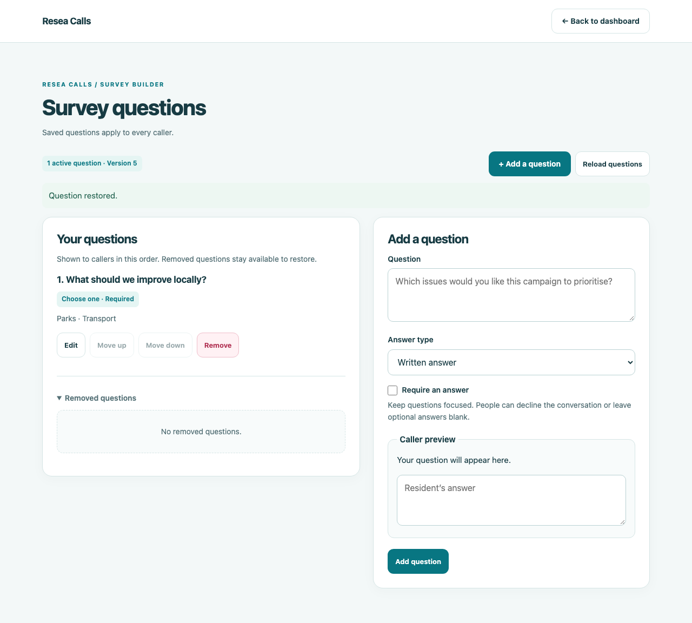

# Resea Calls

A self-hosted calling and survey app for nonprofits, community groups, and campaigns. Free for permitted nonprofit and other noncommercial use under the [PolyForm Noncommercial licence](LICENSE). Commercial use outside those permissions requires a separate agreement; see [commercial licensing](COMMERCIAL.md). You pay for your own hosting, email service, and telephone calls.

Administrators approve callers, import contacts, manage survey questions, and export results. Callers sign in using a code sent to an approved email address, receive one contact at a time, and record the conversation on a phone or computer.

See the [screenshots](docs/screenshots.md).

Source: [openresea/calls](https://github.com/openresea/calls). Commercial enquiries: [resea@tuta.io](mailto:resea@tuta.io).

## Features

- Email codes work with ordinary email providers; access requires administrator approval. Codes expire after 10 minutes, work once, and lock after five incorrect attempts.
- A visual question editor supports written answers, multiple choice, and Yes / No / Not sure. Add, edit, reorder, remove, and restore questions with a caller preview.
- Removed questions and changes to wording do not erase historical answers. Submissions retain the question wording and choices used at the time.
- Contact names, phone numbers, survey answers, and notes are encrypted in PostgreSQL. Admin and caller services use separate database roles.
- One active assignment per caller, a 20-second interval between assignments, and a 30-minute assignment expiry. Duplicate submissions are handled without duplicating results.
- Responsive caller interface, keyboard focus indicators, labelled controls, and visible error messages.



## Local setup

Requires Python 3 and Docker with Compose. These instructions create a fresh database.

```sh
python3 scripts/configure.py
```

The helper asks for the first administrator's email, a verified sender address, and your SMTP server. It creates `.env` with fresh random secrets and owner-only file permissions. It refuses to overwrite an existing file. Edit `.env` to supply your SMTP username/password and any provider-specific settings. Use `SMTP_SECURITY=starttls` with port 587 or `ssl` with port 465. Plaintext SMTP is unsupported.

```sh
docker compose up --build -d
docker compose ps
```

- Caller: `http://localhost:8003/pb/login`
- Administration: `http://localhost:8004/login`

Cookies are always Secure. Local development uses the browser's localhost exception; use a local HTTPS reverse proxy if your browser does not support that exception. Public deployments require HTTPS.

On first startup the database initializes its schema, restricted service roles, and the administrator specified in `.env`. Later changes to `ADMIN_EMAIL` or database passwords in `.env` do not change an existing database; use the admin interface for access management and an explicit database credential rotation for passwords. Preserve the PostgreSQL volume and encryption key.

Sign into administration, approve caller email addresses, import a CSV with `name,phone` columns, then open **Manage survey questions**. [The sample contacts](samples/contacts.example.csv) are fictional. Import limits are 5 MB and 10,000 rows. Test with fictional data first.

Changing a survey while a caller is working asks them to reload questions before saving. Answers that still match the updated choices are retained in the page. Unsaved answers are held only in the page and are lost if it closes or reloads.

## Hosting

The Compose file binds services to loopback and keeps PostgreSQL off host ports. Put admin and caller services on **separate HTTPS hostnames**, behind a reverse proxy; set `ALLOWED_HOSTS` to the exact hostnames. Keep upstream ports private. Configure trusted proxy IPs and forwarded scheme handling explicitly so same-origin checks see HTTPS; never trust arbitrary forwarded headers from the internet. Apply an edge request/body limit and rate limiting, and restrict the admin hostname with a passkey/MFA-capable access gateway before using sensitive data.

SMTP credentials, DNS/sender verification, HTTPS, backups, monitoring, and retention procedures are operator responsibilities. Use a private database network; for a remote database use certificate-verified TLS (`OPS_DB_SSLMODE=verify-full` plus the appropriate libpq CA configuration).

Email sign-in depends on mailbox security and is not phishing-resistant MFA. Image-rendered names and `tel:` redirects reduce casual copying but cannot prevent screenshots, OCR, browser inspection, or phone-number capture. Read [SECURITY.md](SECURITY.md) before handling real contact data.

## Development and verification

```sh
python3 -m venv .venv
.venv/bin/pip install --require-hashes -r requirements.txt
.venv/bin/pip install -r requirements-dev.txt
.venv/bin/python -m pytest -q
.venv/bin/ruff check app tests scripts
```

Without a test database, integration and browser tests skip. For full verification use an **isolated disposable PostgreSQL 17 cluster**, never a production or shared cluster: the fixture creates/drops temporary databases and resets the shared test roles `calls_admin` and `calls_caller`.

```sh
export TEST_DATABASE_DSN='host=127.0.0.1 port=55439 user=postgres dbname=postgres'
.venv/bin/playwright install chromium
RUN_BROWSER_TESTS=1 .venv/bin/python -m pytest -q
```

Browser tests intercept requests into the real ASGI apps backed by that database, mock email delivery, and use fictional contacts. They never place a telephone call. See [verification notes](docs/verification.md) and [CONTRIBUTING.md](CONTRIBUTING.md).

If upgrading an existing Compose installation, set `COMPOSE_PROJECT_NAME=open-calls` in `.env` to keep using its database volume.

## Licence

Source-available under [PolyForm Noncommercial 1.0.0](LICENSE). Keep the licence and [required notice](NOTICE) with copies. For uses outside its permissions, see [commercial licensing](COMMERCIAL.md). Third-party dependencies retain their own licences.
